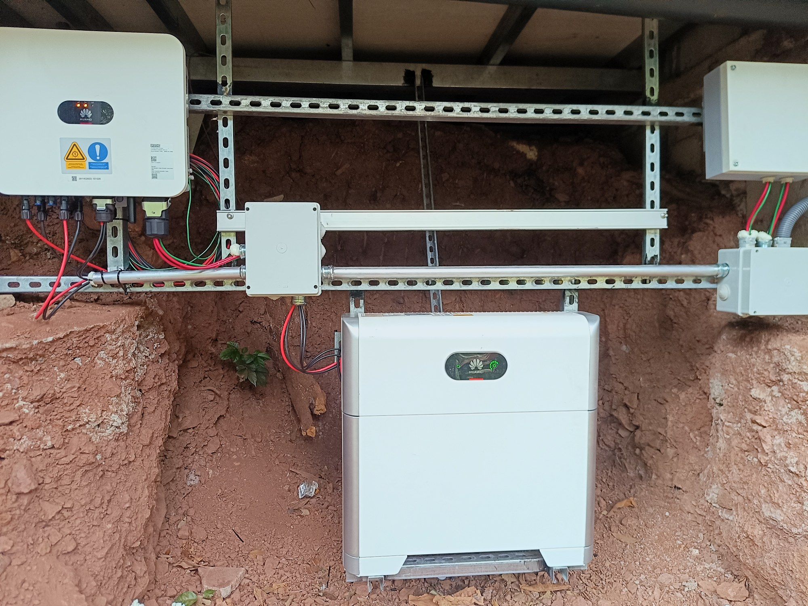

We have added solar panels as part of our commitment to renewable energy and to relying less on conventional sources of electricity.

The system has a capacity of 5.85 kWp. This initiative was supported by the DINÁMICA II program and strengthens our ability to operate with energy-efficiency criteria.

