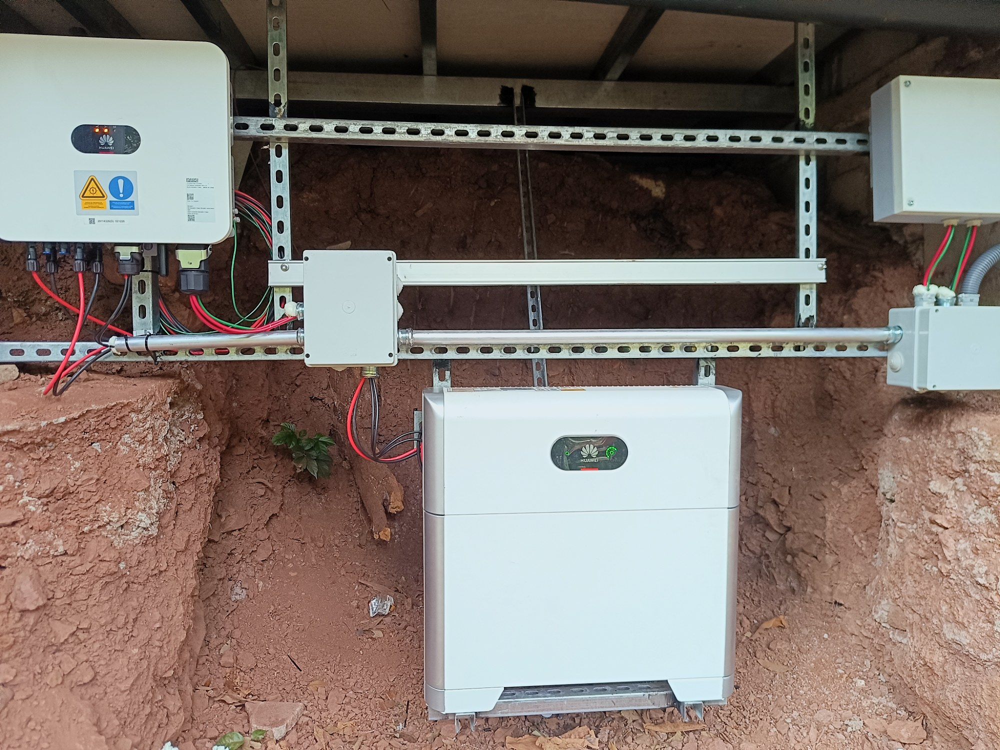

Hemos incorporado paneles solares como parte de nuestro compromiso con el aprovechamiento de energías renovables y la reducción de la dependencia de fuentes convencionales de electricidad.

El sistema tiene una potencia de 5.85 kWp. Esta iniciativa contó con apoyo del programa DINÁMICA II y fortalece nuestra capacidad para operar con criterios de eficiencia energética.

